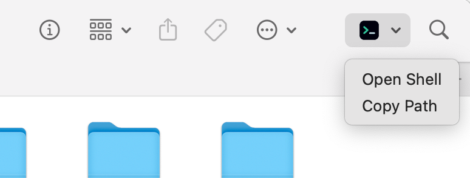
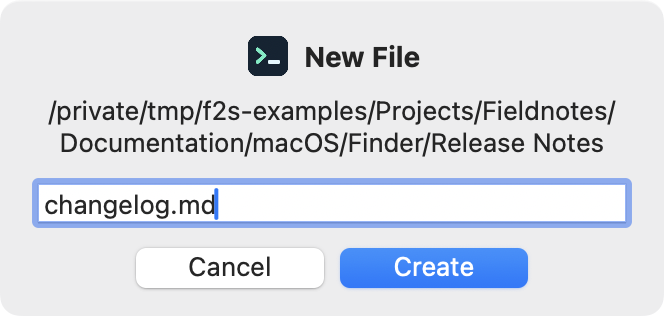

# f2s

[简体中文](README.md) · **English**

Open the current folder in your terminal, copy its path, or create a file from the Finder toolbar. Requires macOS 11 or later on Apple silicon or Intel Macs.

<p>
  
  
</p>

## Install

1. [Download the latest f2s.dmg](https://github.com/yuki-node/f2s/releases/latest/download/f2s.dmg) and double-click it.
2. Drag **f2s** into **Applications**.
3. Open **f2s** from Applications and click **启用 f2s** (Enable f2s).

## Use

Open a folder in Finder and click the **f2s** toolbar icon.

| Menu item | Action |
| --- | --- |
| **Open Shell** | Open the current folder in your default terminal. |
| **Copy Path** | Copy the full path of the current folder to the clipboard. |
| **New File…** | Enter a filename such as `notes.txt` or `.gitignore` and press Return to create an empty file. |
| **Quit f2s** | Quit f2s and disable its Finder extension. |

To use iTerm2, choose **Make iTerm2 Default Term** from the iTerm2 menu.

## Uninstall

Choose **Quit f2s** from the toolbar menu, then move **f2s** from Applications to the Trash.

## Build from source

Install the Xcode Command Line Tools, then run these commands in your terminal.

```sh
git clone https://github.com/yuki-node/f2s.git
cd f2s
bash build.sh
```

The build produces `build/f2s.app` and `build/f2s.dmg`. By default, the app uses an ad hoc signature. To sign with Developer ID, set `APP_SIGNING_IDENTITY`. For Apple notarization, also set `NOTARYTOOL_PROFILE`.
