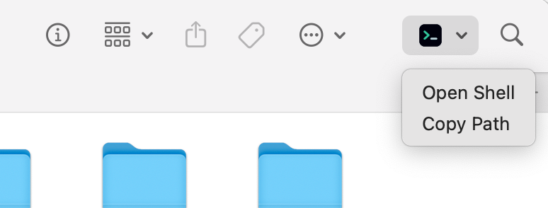

# f2s

f2s 在 macOS Finder 工具栏中添加一个原生下拉菜单，方便你在当前文件夹打开终端、复制路径或创建文件。

支持 macOS 11 及以上版本，安装包同时包含 Apple 芯片和 Intel 架构。

## 安装与使用

1. [下载最新版 f2s.dmg](https://github.com/yuki-node/f2s/releases/latest/download/f2s.dmg)，双击打开，将左侧的 **f2s** 拖到右侧的 **Applications（应用程序）** 文件夹。如果替换旧版时提示正在使用，请先在旧版菜单中选择 **Quit f2s**（如有）。
2. 从系统「应用程序」打开刚拷入的 **f2s**。如果升级后打开 f2s 会直接弹出终端，请检查个人「应用程序」（`~/Applications`）里是否还留有早期的 f2s。确认系统「应用程序」中已有新版后，可将个人目录中的旧版移到废纸篓。
   如果看到「未打开 ‘f2s’」且提示 Apple 无法验证应用，先点「完成」。确认下载来源可信后，双击 DMG 中的 **首次打开说明.html**，点击其中的链接打开「隐私与安全性」。也可以从苹果菜单进入「系统设置」→「隐私与安全性」，在「安全性」下找到 f2s，点「仍要打开」并按提示确认。[Apple 官方说明](https://support.apple.com/zh-cn/102445)
   首次启动后，点「启用 f2s」直接启用 Finder 扩展。如果看到「f2s 已启用」，点「好」即可。随后可以推出磁盘映像。
3. 在 Finder 中打开文件夹，点击工具栏的 **f2s** 图标即可使用。若扩展已启用但按钮仍不可见，可在 Finder 的「显示 → 自定义工具栏」中添加 f2s。

f2s 优先使用 macOS 为 Unix 可执行文件登记的默认终端（Shell 角色）。如果你使用 iTerm2，可在其应用菜单中选择 **Make iTerm2 Default Term**。如果该关联不可用，f2s 会尝试与 `.command` 文件关联的终端，最后回退到系统「终端」。

如果系统阻止 Finder 扩展直接打开文件夹，f2s 主应用会核对当前 Finder 路径并重试。首次重试时，macOS 可能询问是否允许 f2s 访问 Finder。

## 工具栏菜单



- **Open Shell** 在当前文件夹打开用户配置的终端，例如 iTerm2 或系统「终端」。新会话使用该终端配置的 shell。
- **Copy Path** 将当前文件夹的绝对路径以纯文本复制到剪贴板，保留中文、空格和特殊字符。
- **New File…** 输入完整文件名（例如 `test.txt`、`test.log` 或 `.gitignore`），按回车即可在当前文件夹创建空文件，并在 Finder 中选中它。同名时可以重新输入。
- **Quit f2s** 关闭当前账户的 f2s 窗口并停用 Finder 扩展。要恢复工具栏按钮，重新打开 f2s 并选择「启用 f2s」。

<details>
<summary>查看 New File… 弹窗</summary>


</details>

## 卸载

如果 Finder 工具栏里有 f2s，先从它的菜单选择 **Quit f2s**。然后在 Finder 的「应用程序」里选中 **f2s**，按 **⌘⌫** 将它移到废纸篓。macOS 通常会自动从启动台移除图标，无需清空废纸篓。如果以前也在个人「应用程序」（`~/Applications`）里安装过 f2s，卸载时请一并检查那份副本。[Apple 卸载说明](https://support.apple.com/zh-cn/102610)

## 从源码构建

在装有 Xcode Command Line Tools 的 Mac 上运行：

```sh
git clone https://github.com/yuki-node/f2s.git
cd f2s
bash build.sh
```

构建产物位于 `build/`，包括 `f2s.app` 和可分发的只读磁盘映像 `f2s.dmg`。每个 GitHub Release 上传一个 `f2s.dmg`，上面的下载链接会指向最新版。

## 项目结构

| 路径 | 内容 |
| --- | --- |
| `FinderExtension/` | Finder Sync 扩展，提供原生工具栏按钮和菜单 |
| `Sources/App/` | 主应用、Finder 目录读取和旧版工具栏迁移 |
| `Sources/Shared/` | 主应用和扩展共用的终端选择与路径复制逻辑 |
| `Resources/` | 应用配置、权限声明和图标 |
| `Installer/` | DMG 的 Finder 窗口布局 |

## 签名与公证

默认构建对应用及其内嵌组件使用本地临时签名，DMG 未经 Developer ID 签名和 Apple 公证。在其他 Mac 上首次打开应用时可能遇到 Gatekeeper 提示。[Apple 安装说明](https://support.apple.com/zh-cn/102445)

使用 Developer ID 分发时，将 `APP_SIGNING_IDENTITY` 设为钥匙串中的 Developer ID Application 证书名称，再执行 `bash build.sh`。同时设置 `NOTARYTOOL_PROFILE` 后，构建脚本会提交 DMG 公证并将票据附加到磁盘映像。
