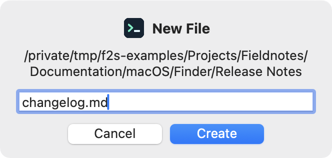

# f2s

f2s 在 macOS Finder 工具栏中添加一个原生下拉菜单，方便你在当前文件夹打开终端、复制路径或创建文件。

支持 macOS 11 及以上版本，安装包同时包含 Apple 芯片和 Intel 架构。

## 安装与使用

1. [下载最新版 f2s 安装包](https://github.com/yuki-node/f2s/releases/latest/download/f2s.pkg)，双击 `.pkg` 并按提示安装。应用会安装到 `/Applications/f2s.app`，安装程序会为当前桌面账户注册 Finder 扩展。
2. 在 Finder 中打开文件夹，单击工具栏的 **f2s** 图标，选择所需操作。
3. 如果看不到按钮，从「应用程序」打开 f2s，按提示启用 Finder 扩展。已启用时，可在 Finder 的「显示 → 自定工具栏」中添加 f2s 按钮。其他账户可以单独启用或停用扩展。

f2s 优先使用 macOS 为 Unix 可执行文件登记的默认终端（Shell 角色）。如果你使用 iTerm2，可在其应用菜单中选择 **Make iTerm2 Default Term**。如果该关联不可用，f2s 会尝试与 `.command` 文件关联的终端，最后回退到系统「终端」。

如果系统阻止 Finder 扩展直接打开文件夹，f2s 主应用会核对当前 Finder 路径并重试。首次重试时，macOS 可能询问是否允许 f2s 访问 Finder。

## 工具栏菜单


- **Open Shell** 在当前文件夹打开用户配置的终端，例如 iTerm2 或系统「终端」。新会话使用该终端配置的 shell。
- **Copy Path** 将当前文件夹的绝对路径以纯文本复制到剪贴板，保留中文、空格和特殊字符。
- **New File…** 输入完整文件名（例如 `test.txt`、`test.log` 或 `.gitignore`），按回车即可在当前文件夹创建空文件，并在 Finder 中选中它。同名时可以重新输入。

<details>
<summary>查看 New File… 弹窗</summary>



</details>

## 从源码构建

在装有 Xcode Command Line Tools 的 Mac 上运行：

```sh
git clone https://github.com/yuki-node/f2s.git
cd f2s
bash build.sh
```

构建产物位于 `build/`，包括 `f2s.app` 和带版本号的 `.pkg` 安装包。每个 GitHub Release 只上传一份安装包，统一命名为 `f2s.pkg`，以便安装说明中的下载链接始终指向最新正式版。

## 项目结构

| 路径 | 内容 |
| --- | --- |
| `FinderExtension/` | Finder Sync 扩展，提供原生工具栏按钮和菜单 |
| `Sources/App/` | 主应用、Finder 目录读取和旧版工具栏迁移 |
| `Sources/Shared/` | 主应用和扩展共用的终端选择与路径复制逻辑 |
| `Resources/` | 应用配置、权限声明和图标 |
| `Installer/` | 安装包配置及安装后脚本 |

## 签名与公证

默认构建对应用和扩展使用本地临时签名，生成的安装包未经 Developer ID 签名和 Apple 公证。在其他 Mac 上安装时可能遇到 Gatekeeper 提示。[Apple 安装说明](https://support.apple.com/zh-cn/102445)

使用 Developer ID 分发时，将 `APP_SIGNING_IDENTITY` 和 `INSTALLER_SIGNING_IDENTITY` 分别设为钥匙串中的 Developer ID Application 和 Developer ID Installer 证书名称，再执行 `bash build.sh`。同时设置 `NOTARYTOOL_PROFILE` 后，构建脚本会提交公证并将票据附加到安装包。
